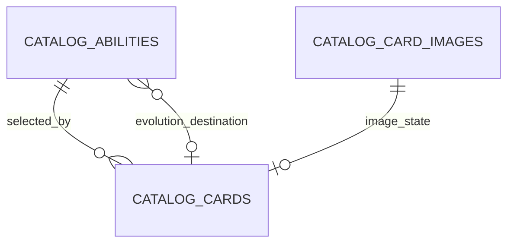
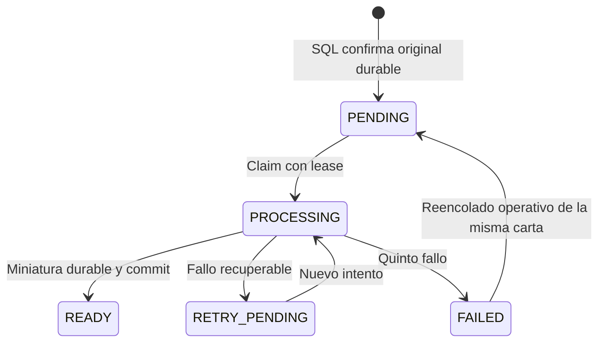
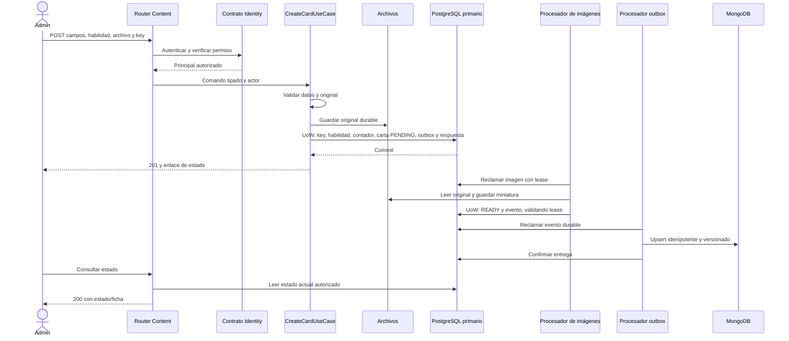

# Diseño técnico de Crear Carta — Sprint 1

Fecha: 2026-10-23. Épica: Contenido del Juego. Feature: F-02, Catálogo de Cartas. User Story: 2.1.1, Crear carta.

Estado: diseño para implementar, completado por delegación del usuario. No se implementan endpoints, migraciones ni pruebas mediante este documento.

## 1. Fuentes y límites

Leer primero [module-design.md](module-design.md), [AGENTS.md](../../../AGENTS.md), [contrato](../../../DocsE/contrato.md), [User Stories](../../../DocsE/pokearena_user_stories_v3_3.csv), [Features](../../../DocsE/pokearena_features_v3.csv) y [mapping](../../../DocsE/pokearena_full_mapping_v3.xlsx). Las referencias arquitectónicas están en `module-design.md`.

Las reglas de éxito, error y alternos de US 2.1.1 son obligatorias. Las decisiones de imágenes están en [ADR-002](../../adr/ADR-002-create-card-images.md). Los nombres de componentes y políticas concretas de este documento son decisiones técnicas, no nuevos requisitos funcionales del caso.

No se implementan Crear Habilidad, Buscar Carta, Crear Ubicación ni el login/sesiones completos. Se implementan sus puntos mínimos de integración y se coordina el consumo de contratos/DTO compartidos.

## 2. Decisiones cerradas y limitación de capacidad

| Tema | Decisión |
| --- | --- |
| Miniaturas | Asíncronas, con original validado y durable antes de aceptar la creación. ADR-002 define estados y recuperación. |
| Identidad | Consumir el contrato público de Identity; credenciales propias de plataforma, sin atajos productivos. |
| Habilidades | Referenciar definición existente por `ability_code`; carga idempotente de `HAB-000`; no aceptar definiciones nuevas en el request. |
| Idempotencia | Cabecera obligatoria, ámbito por actor y operación, con huella de payload y respuesta guardada en el mismo UoW. |
| HTTP | 201 para carta administrativa pendiente; 200 para consultar estado; 401/403 separados; 422 para validaciones; 409 para conflicto idempotente/capacidad. |
| Imágenes | 5.000.000 bytes, 5:7 exacto, mínimo 600 × 840, original preservado y miniatura WebP 200 × 280. |
| Compatibilidad | Entrega coordinada de API, formulario, DTOs compartidos y adaptador de proyección, con pruebas de consumidores. |
| Secuencia | Diagrama de este documento como especificación concreta del flujo; no se presume otro diagrama aprobado ausente del checkout. |

### Capacidad de códigos

Se conserva estrictamente `PKA-<TIPO>-<NNN>` con tres dígitos y secuencia 001–999 por cada uno de los seis tipos. Al agotarse un tipo se responde 409 `CATALOG_CODE_CAPACITY_EXHAUSTED`, sin crear carta ni consumir otra secuencia.

Esto permite 5.994 códigos válidos y es incompatible con poblar simultáneamente 10.000 cartas bajo esas mismas restricciones. La decisión técnica es preservar el formato oficial, dimensionar el almacenamiento para el volumen indicado y dejar registrada la incompatibilidad. No se declara satisfecha la capacidad funcional de 10.000 cartas ni se inventa un séptimo tipo, reutilización de códigos o cuatro dígitos. Ampliarla requiere una excepción o actualización funcional explícita del Product Owner; no es una nueva elección de arquitectura.

## 3. Componentes y reglas

`CreateCardUseCase` recibe un comando con nombre, costo, poder, tipo, rareza, código de habilidad, imagen validada, actor e idempotencia. Nunca recibe el código de carta generado por el cliente.

El dominio valida costo 0–10 y poder -20–20. Tipos: FUE, AGU, PLA, ELE, PSI, LUC. Rarezas de API: COMUN, POCO_COMUN, RARA, LEGENDARIA. Nombre requerido, sin blancos únicamente. El límite de longitud actual de 100 caracteres se conserva como límite de almacenamiento/API del setup, identificado como técnico y no como una regla adicional del caso. No se impone unicidad de nombre.

Se separa validación de original y generación de miniatura. El dominio recibe metadatos de imagen; Pillow permanece en infraestructura. `Card` referencia una habilidad obligatoria y un registro de procesamiento de imagen. `is_available_to_players` se deriva de `READY` y ambas referencias de archivo; no se administra otro flag independiente.

El caso de uso de creación no importa un cliente Mongo ni llama a `sync_card_projection`. Agrega eventos al outbox SQL.

## 4. Habilidades existentes

La solicitud proporciona `ability_code`. Se consulta en el primario SQL y se vuelve a comprobar dentro del UoW antes de asociarla.

- Ausente, nulo o vacío: 422 `CATALOG_ABILITY_REQUIRED`.
- Código inexistente: 422 `CATALOG_ABILITY_NOT_FOUND`.
- `HAB-000`: definición persistida Sin Habilidad, sin efecto. Es una selección válida explícita; el backend no la asigna silenciosamente si falta el campo.
- Otra habilidad: usar la definición existente, sin aceptar parámetros del cliente que la alteren.
- No se exige que el tipo de la carta coincida con el tipo afectado por la habilidad; esa restricción no está documentada.

La definición compartida contiene disparador, condición, efecto, objetivo, tipo afectado, selección determinista cuando aplique y parámetros tipados. Se respetan las combinaciones de US 2.1.3: Evolucionar y Mover son continuos sobre esta carta; Descartar actúa en manos; Destruir no actúa en manos; Ganar energía corresponde al dueño. Evolucionar no admite condición «siempre».

Rangos de las definiciones consumidas: modificar poder -10..10, modificar costo -5..5, energía +1..+5, movimientos 1..3 y parámetros de condición dentro del catálogo oficial. Estas reglas no crean un endpoint de edición/creación de habilidades. Si una definición persistida viola el catálogo, no se la corrige silenciosamente; se registra error de integridad y se coordina con su responsable.

La carga de `HAB-000` es idempotente y no fabrica otras habilidades. El formulario permite ingresar/seleccionar el código existente y presenta la definición validada en la ficha. Un listado avanzado de habilidades queda fuera de esta historia.

### Evolución

Comprobar destino existente, distinto del ID de la carta y grafo sin ciclos antes de persistir la asociación. El servicio puro `EvolutionGraphValidator` recibe el grafo obtenido por repositorio.

El orden de bloqueos es: reserva idempotente, bloqueo transaccional del grafo de evolución, contador del tipo y filas de contenido. Se usa un bloqueo advisory transaccional común de PostgreSQL para las operaciones que agregan relaciones de evolución. Los futuros escritores del catálogo deben respetar ese mismo protocolo; se documenta en el contrato interno del módulo.

En un flujo exclusivamente de creación con ID nuevo y destinos preexistentes, algunos ciclos no son construibles por requests válidos. Se mantienen validación defensiva y tests con grafos preparados. No se implementa edición para producirlos.

## 5. Modelo relacional objetivo

Se conserva `VARCHAR(36)` para identificadores internos, consistente con el setup actual, representando UUIDs generados por la aplicación. No se solicita una conversión general de tipos de ID.

| Tabla | Columnas relevantes | Integridad e índices |
| --- | --- | --- |
| `catalog_cards` | `id PK`, `code VARCHAR(30)`, `name VARCHAR(100)`, `cost SMALLINT`, `power SMALLINT`, `card_type`, `rarity`, `ability_id`, `image_id`, `version BIGINT`, `created_at TIMESTAMPTZ` | NOT NULL; UNIQUE(code); UNIQUE(image_id); FK a habilidad e imagen; CHECK de rangos y catálogos; código coherente con tipo; version >= 1. |
| `catalog_abilities` | `id PK`, `code`, `name`, disparador, condición, efecto, objetivo, tipo afectado, parámetros JSONB tipados y `evolution_target_card_id NULL` | UNIQUE(code); FK de destino a `catalog_cards`; `HAB-000` reservado; restricciones locales del catálogo y validación de combinaciones en dominio. |
| `catalog_card_images` | `id PK`, `original_storage_key`, `original_sha256`, formato, bytes, ancho/alto, `thumbnail_storage_key NULL`, `state`, intentos, generación de procesamiento, lease/token, `next_attempt_at`, error sanitizado, fechas | Original requerido y válido; CHECK de estados; READY requiere miniatura; contadores no negativos; índice de trabajo por state/next_attempt_at y lease vencido. |
| `catalog_card_code_counters` | `card_type PK`, `last_value INTEGER` | Seis filas iniciales en 0; CHECK 0..999. |
| `shared_idempotency_records` | actor, operación, llave <= 128 caracteres, `request_hash CHAR(64)`, recurso, respuesta/status, fecha | UNIQUE(actor, operation, key); respuesta JSONB; registro completado en la misma transacción que la carta. |
| `shared_outbox` | `id PK`, tipo, agregado/ID, versión, `schema_version`, payload JSONB, estado, intentos, próxima ejecución, lease/token, fechas | UNIQUE(aggregate_type, aggregate_id, aggregate_version); índice parcial de pendientes; payload durable. |

Los parámetros JSONB no admiten reglas arbitrarias ni código ejecutable. El conjunto de tipos sigue cerrado y se valida con tipos definidos en dominio.

La inmutabilidad del código se protege en dominio/repositorio y mediante una protección SQL contra su actualización. El acceso a las tablas de habilidades sigue dentro de Content. Las referencias desde documentos Mongo no son FKs físicas.



`ability_spec`, `image_url` y `thumbnail_url` actuales requieren transición coordinada hacia las relaciones propuestas. No se eliminan datos existentes ni se convierten automáticamente habilidades libres en definiciones válidas. Antes de migrar se obtiene un inventario y una correspondencia explícita con el responsable del catálogo. Las cartas incompatibles deben identificarse, no borrarse.

## 6. Transacción, código e idempotencia

La llave idempotente identifica una creación lógica, no cada intento HTTP. El frontend la conserva para reintentar el mismo payload y genera otra cuando inicia una nueva creación o modifica los datos.

La huella SHA-256 utiliza la serialización canónica de nombre normalizado mediante trim, costo, poder, tipo, rareza, código de habilidad y hash de los bytes originales. Incluye todos los datos relevantes; no incluye credenciales. El ámbito de unicidad ya contiene actor y operación.

1. Autenticar y autorizar antes de leer respuestas almacenadas.
2. Validar campos y original; calcular la huella. Consultar un resultado idempotente existente en el primario como optimización.
3. Almacenar el original válido con clave de intento única. Si falla, no crear la carta.
4. Abrir UoW y reservar la clave mediante la restricción única SQL. Una colisión concurrente espera el commit/rollback del primer escritor; no se permite «consultar y luego insertar» sin unicidad.
5. Si ya existe: misma huella devuelve la respuesta original; otra huella produce 409 `IDEMPOTENCY_KEY_REUSED`. Limpiar únicamente el archivo propio no referenciado.
6. Revalidar habilidad/grafo, bloquear el contador con `SELECT ... FOR UPDATE`, incrementar y formar el código. No usar `MAX + 1` por solicitud.
7. Guardar carta, imágenes PENDING, evento CardCreated y respuesta idempotente 201 en la misma sesión y transacción.
8. Confirmar. Una excepción revierte todas las escrituras SQL y el contador. Una creación aceptada conserva su único código incluso si después fallan las imágenes.

El registro IN_PROGRESS, si se usa durante la reserva, no se confirma de forma separada. No quedan reservas durables huérfanas por caída de una transacción. Las respuestas aceptadas se conservan durante Sprint 1 sin TTL automático, para no habilitar duplicados por olvido prematuro de la llave.

Los datos actuales ya contienen códigos suministrados por clientes. La inicialización del contador toma esos códigos válidos bajo exclusión de escritores, antes de habilitar el nuevo asignador; no realiza ese cálculo en cada request. Valores inválidos o tipos no oficiales requieren conciliación, no corrección automática.

Si el resultado del commit es incierto, consultar el primario por la clave. No borrar el original hasta confirmar que ninguna carta aceptada lo referencia. Un fallo Mongo nunca revierte este commit ni justifica eliminar archivos.

## 7. Imágenes y recuperación

La política completa está en ADR-002. No se confía únicamente en MIME o extensión. Pillow decodifica el formato real; se rechazan datos corruptos y se verifican 5.000.000 bytes, proporción exacta y resolución mínima. El original se conserva; la miniatura WebP es exactamente 200 × 280.

Los estados son administrativos, no estados del motor de juego:



Tras reclamar trabajo se hace I/O fuera de la transacción. Antes de publicar READY se valida la propiedad del lease en un nuevo UoW. El fallo de finalización revierte ese UoW. Registrar RETRY_PENDING/FAILED ocurre en otra transacción válida. Un trabajador obsoleto no puede publicar.

Antes de READY no se anuncian URLs listas para consumo por jugadores. El original permanece en almacenamiento controlado y la respuesta puede usar URLs nulas. En READY ambas referencias apuntan a archivos durables. Una caída entre guardar miniatura y confirmar SQL produce un archivo conciliable, no disponibilidad falsa.

## 8. API y DTOs

El futuro `docs/openapi/content-create-card.yaml` se redacta como OpenAPI 3.0 y se revisa antes de implementar los endpoints. Este documento no crea ese YAML.

### POST /api/v1/content/cards

Autenticación: Bearer de plataforma. Cabecera `Idempotency-Key` obligatoria, no vacía, máximo 128 caracteres. Request `multipart/form-data`:

| Campo | Validación |
| --- | --- |
| `name` | String obligatorio, trim, 1..100 caracteres. |
| `cost` | Entero 0..10. |
| `power` | Entero -20..20. |
| `card_type` | FUE / AGU / PLA / ELE / PSI / LUC. |
| `rarity` | COMUN / POCO_COMUN / RARA / LEGENDARIA. |
| `ability_code` | String obligatorio que referencia una definición existente. |
| `image` | Archivo obligatorio, sujeto a validación real de contenido. |

Se rechazan los antiguos campos de entrada `code`, `ability_type`, `ability_description` y `ability_params_json`, con error explícito que permita detectar un cliente desactualizado. No se ignoran silenciosamente valores que antes definían la carta.

Respuesta 201: `id`, `code`, nombre, costo, poder, tipo, rareza, definición de habilidad y estado de imágenes. Cabecera `Location` al endpoint de estado. El resultado inicial tiene PENDING; es la aceptación durable de la carta administrativa, no una confirmación de que ya puede jugarse.

```json
{
  "id": "uuid-de-carta",
  "code": "PKA-FUE-001",
  "name": "Nombre",
  "cost": 2,
  "power": -1,
  "card_type": "FUE",
  "rarity": "COMUN",
  "ability": {
    "code": "HAB-000",
    "name": "Sin Habilidad",
    "trigger": null,
    "effect": null,
    "affected_card_type": null,
    "parameters": {}
  },
  "image_status": "PENDING",
  "image_url": null,
  "thumbnail_url": null,
  "available_to_players": false,
  "status_url": "/api/v1/content/cards/uuid-de-carta/image-status"
}
```

La respuesta idempotente repite el snapshot inicial y el status 201. Aunque las imágenes hayan avanzado, el enlace permite consultar el recurso actual. La respuesta nunca cambia de carta/código por un reintento.

### GET /api/v1/content/cards/{card_id}/image-status

Solo administrador. Lee del primario, para reflejar la propia creación. Devuelve 200 con ID/código, estado actual, intentos, diagnóstico sanitizado si falló y URLs cuando esté READY; incluye la ficha completa de la carta para que el formulario muestre su resultado. Recurso inexistente: 404. Esta consulta limitada cumple el criterio de estado visible; no agrega búsqueda ni edición general.

### Respuestas de error

| HTTP | Regla |
| --- | --- |
| 401 | Credencial ausente, inválida o expirada. |
| 403 | Usuario autenticado sin permiso de administrador. |
| 422 | Formato/valores/archivo/habilidad/asociación inválidos, campo faltante o campos de entrada retirados. |
| 404 | Carta inexistente en consulta de estado. |
| 409 | Llave idempotente con otro contenido o espacio de códigos agotado. |
| 503 | Identity, primario SQL o almacenamiento original no disponibles; o espera transaccional agotada sin confirmar aceptación. |
| 500 | Fallo inesperado, sanitizado y correlacionado. |

Se elige 422 para validación de esta operación; 400 queda reservado a solicitudes HTTP malformadas que no puedan interpretarse. Los handlers mantienen el formato exacto del contrato:

```json
{
  "error": {
    "code": "CATALOG_INVALID_CARD_COST",
    "message": "El costo de la carta debe ser un número entero entre 0 y 10.",
    "details": [{"field": "cost", "issue": "Valor fuera del rango permitido."}],
    "correlation_id": "identificador-de-solicitud",
    "timestamp": "2026-10-23T18:00:00Z"
  }
}
```

No exponer stacktraces, credenciales, SQL ni rutas internas. Los intentos del worker conservan el identificador de correlación original y registran identificadores de carta/evento/intento.

## 9. Secuencia y proyección Mongo



`CardCreated` publica versión 1 y el estado pendiente. `CardImageStateChanged` publica una versión nueva por cambio observable de estado. Ambos usan envelope con `event_id`, `aggregate_id`, `aggregate_version`, `schema_version=1`, tipo, fecha, correlación y snapshot de proyección.

El snapshot incluye código, campos de carta, definición de habilidad, estado y URLs disponibles. No contiene bytes de imagen, secretos o datos privados de identidad. `cards_projection._id` conserva el ID de carta como referencia lógica.

El dispatcher usa reclamación SQL con lease. Mongo debe aplicar el reemplazo/upsert de forma atómica solo si la versión recibida es más nueva; duplicados o versiones antiguas son no-ops. La implementación debe probar que una carrera de inserción/versionado no elimina un documento más nuevo.

La entrega es al menos una vez con efecto idempotente. Si el proceso cae después de escribir Mongo y antes del acuse SQL, se reenvía el evento. No se usa un único flag de procesado para varias entregas distintas del mismo evento; cada fila actual de outbox de este alcance tiene un destino de proyección.

El reintento de outbox no descarta eventos: espera exponencial de 2 segundos hasta un máximo de 300 segundos entre intentos, con alerta a partir del quinto fallo. Una caída Mongo no falla el POST ya confirmado ni elimina imágenes. La proyección se puede reconstruir desde el catálogo SQL.

## 10. Compatibilidad e integración del setup

La entrega debe coordinar en la misma versión de aplicación:

1. Quitar código editable y parámetros de habilidad libre de `CreateCardForm`.
2. Enviar `ability_code` obligatorio, con HAB-000 como opción visible del formulario, sin default silencioso en el backend.
3. Corregir rangos/catálogos en tipos TypeScript y backend.
4. Conservar la key para el reintento de la misma creación.
5. Mostrar estado de procesamiento y ficha; consultar estado cada dos segundos mientras esté activo y detener polling al desmontar o llegar a READY/FAILED. Los errores de consulta se muestran y permiten reintentar sin recrear la carta.
6. Admitir URLs nulas antes de READY y usar placeholder, evitando que `CardItem` u otro consumidor se rompa.
7. Ampliar el DTO de habilidad con código, disparador, efecto, parámetros y tipo afectado. Los campos legacy de respuesta necesarios por consumidores actuales pueden mantenerse temporalmente como valores derivados y documentados como deprecados; nunca son otra fuente de verdad ni vuelven a aceptarse en el POST.
8. Actualizar el adaptador de eventos hacia Mongo para el nuevo snapshot, sin implementar filtros de Buscar Carta.
9. Actualizar pruebas que usan costo 1..6, poder no negativo, imágenes 500 × 700 y códigos aportados por cliente.

Este request corrige una incompatibilidad deliberada del endpoint actual de desarrollo. El OpenAPI debe registrar la ruptura y los consumidores conocidos se actualizan juntos; no se oculta la incompatibilidad en CI. Si existen consumidores externos activos, se necesita despliegue con transición compatible/versionada antes de retirar sus campos.

La migración desde habilidades JSON actuales requiere correspondencia de datos con el responsable de US 2.1.3. Se implementa el repositorio de lectura y la referencia; no su interfaz de creación ni un catálogo inventado para demostrar la historia.

## 11. Matriz de criterios y pruebas

S/E/A son etiquetas locales para los criterios en el orden de la historia. Todas las pruebas de esta tabla están planificadas; no se afirma su ejecución.

| ID | Criterio | Prueba y evidencia esperada |
| --- | --- | --- |
| S1 | Carta con campos requeridos disponible en catálogo. | Integración: 201 durable, SQL correcto, procesamiento READY y proyección eventual; ficha coherente. |
| S2 | Formatos, tamaño, proporción y resolución de original. | Parametrizadas: PNG/JPEG/WebP, 5.000.000 y 5.000.001 bytes, 600 × 840 y resoluciones inferiores con proporción válida. |
| S3 | Miniatura 200 × 280 y ambas imágenes antes de disponibilidad. | Abrir miniatura, comprobar dimensiones; todos los estados no READY mantienen disponibilidad falsa. |
| S4 | Código único e inmutable por tipo. | Prefijos seis tipos, formato 001, consecutivo, restricción SQL/inmutabilidad y agotamiento en 999. |
| S5 | Rangos y catálogos oficiales. | Límites 0/10 y -20/20; rechazo -1/11 y -21/21; seis tipos/cuatro rarezas; rechazar INC/EPICA. |
| S6 | Habilidad obligatoria y HAB-000. | Seed idempotente, asociación a HAB-000 y otras definiciones válidas, sin crear otra habilidad. |
| S7 | Ficha muestra tipo, habilidad y tipo afectado. | Contrato API y presentación: definición/parametrización de habilidad y caso sin efecto. |
| E1 | Solicitud sin credenciales. | API 401, sin carta, archivos aceptados ni incremento de contador. |
| E2 | Usuario sin rol administrador. | API 403, distinto de 401 y sin efectos. |
| E3 | Valores de costo/poder/tipo/rareza inválidos. | 422 con campo e invariantes SQL; no aceptar efectos del request. |
| E4 | Original inválido rechazado y carta no guardada. | MIME engañoso, formato no permitido, corrupto, tamaño, resolución y proporción; sin carta/código consumido. |
| E5 | Fallo de miniatura, reintento y estado visible. | Fallo inyectado, GET administrativo, recuperación, quinto fallo FAILED, reencolado sin otra carta. |
| E6 | Habilidad omitida. | Ausente/nula/vacía: 422 con ability_code; sin fallback automático. |
| E7 | Código de habilidad inexistente. | 422; ninguna carta o código consumido. |
| E8 | Evolución hacia sí misma. | Validación pura y asociación inválida en caso de uso; sin persistencia. |
| A1 | Reenvío no duplica carta ni consume código. | Dos solicitudes secuenciales y simultáneas misma key/payload: un ID/código, una operación y mismo snapshot. |
| A2 | Creaciones simultáneas del mismo tipo. | Conexiones independientes y distintas keys: códigos diferentes, sin colisión. |
| A3 | Ciclos de evolución rechazados. | Grafos de dos/más cartas y protocolo de bloqueo de escritores; sin añadir edición a la historia. |
| A4 | Elección síncrona/asíncrona en ADR. | Revisión ADR-002 y pruebas del flujo asíncrono elegido. |

Pruebas técnicas adicionales: misma key con otro payload (409), aislamiento de key entre actores, validación antes de replay, rollback tras asignación de código, fallo de guardado original, caída entre archivo y commit, commit incierto, lease perdido, dos workers, eventos fuera de orden, duplicados y recuperación de Mongo caído. Incluir orientación y formatos multiframe según ADR-002.

Unitarias: dominio, habilidad consumida, validación/grafo y orquestación con dobles. Integración: PostgreSQL y Mongo de prueba, almacenamiento temporal y API con contrato Identity sustituido. Concurrencia: conexiones y workers independientes. Arquitectura: conservar el checker existente para capas/módulos y asegurar que solo el adaptador de Identity importa su contrato público.

La prueba integrada existente trunca tablas y no cubre por sí sola esta matriz. Se usará una base de pruebas dedicada. La suite actual codifica reglas antiguas; que pase no demuestra aceptación de la historia. No se añade un framework frontend: se valida compilación TypeScript, contrato de payload y recorrido de creación/errores mediante el mecanismo de verificación acordado para frontend.

## 12. Orden de implementación y condiciones de cierre

1. Publicar/revisar OpenAPI con este contrato, incluyendo respuesta PENDING y errores.
2. Coordinar contrato Identity y modelo compartido de habilidades; inventariar datos existentes.
3. Implementar dominio/DTO y pruebas de reglas oficiales.
4. Preparar el cambio SQL para carta/habilidad/imágenes/contador/idempotencia/outbox, sin pérdida de datos.
5. Implementar UoW de creación, autorización e idempotencia concurrente.
6. Implementar procesamiento durable, estado y recuperación según ADR-002.
7. Conectar productor/consumidor de eventos y frontend coordinados.
8. Ejecutar matriz pertinente, pruebas de arquitectura, Ruff/Mypy y compilación frontend; reportar evidencia y criterios pendientes.

La historia no está terminada si solo funciona HAB-000 con un doble de autorización y faltan integración Identity, casos de evolución o recuperación. Las dependencias están diseñadas, pero todavía necesitan implementación y coordinación de sus responsables. La incompatibilidad funcional de 10.000 cartas frente a códigos de tres dígitos permanece expresamente registrada; no debe ocultarse en pruebas o datos sintéticos presentados como catálogo válido.

No se implementará otra User Story, no se cambiará el contrato/arquitectura ni se hará commit o push sin autorización correspondiente.
