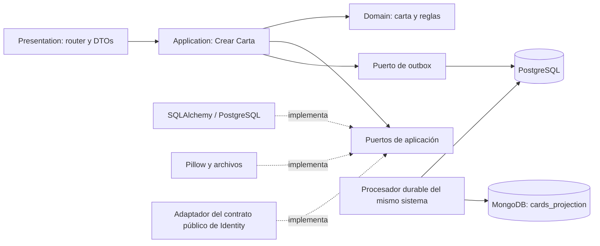

# Diseño del módulo Content para Crear Carta

Fecha: 2026-10-23. Alcance: Sprint 1, F-02, US 2.1.1.

Este documento registra el diseño técnico elegido por delegación del usuario. Describe el objetivo de implementación; no afirma que estos componentes ya estén implementados. Conserva el monolito modular hexagonal, el stack y las fronteras del contrato de programación.

## 1. Fuentes y alcance

- [AGENTS.md](../../../AGENTS.md).
- [Contrato de programación](../../../DocsE/contrato.md), apartados 1 a 6.
- [User Stories](../../../DocsE/pokearena_user_stories_v3_3.csv): Crear carta; Crear habilidad se consulta únicamente para consumir su catálogo.
- [Features](../../../DocsE/pokearena_features_v3.csv): Catálogo de Cartas.
- [Mapping](../../../DocsE/pokearena_full_mapping_v3.xlsx): hoja `Detalle de User Stories`, US 2.1.1 y dependencia US 2.1.3.
- [ADR-001](<../../../DocsE/Estructuras/Seleccion de Arquitectura de Referencia.md>).
- [Drivers arquitectónicos](<../../../DocsE/Estructuras/Drivers Arquitectónicos Poké-Arena.md>).
- [Arquitectura lógica](<../../../DocsE/Estructuras/Arquitectura lógica del sistema Pokémon Arena.md>).
- [Contexto del sistema](<../../../DocsE/Estructuras/Alcance y Diagrama de Contexto.md>).
- [Diseño de Crear Carta](create-card.md).
- [ADR-002: imágenes](../../adr/ADR-002-create-card-images.md).

Los requisitos funcionales proceden de estas fuentes. Los nombres nuevos de clases, tablas, mensajes y políticas operativas son decisiones de implementación de este diseño. No modifican los archivos originales.

ADR-001 conserva el estado documental «Propuesto»; el usuario establece esta arquitectura como la referencia aprobada del trabajo. No se cambia el estado del ADR-001 desde estos documentos. No se encontraron diagramas de secuencia específicos de Crear Carta en el checkout; el diagrama de `create-card.md` concreta el flujo para esta implementación.

Incluye crear una carta, asociar una habilidad existente, procesar sus imágenes, aplicar autorización e idempotencia y producir los eventos necesarios para su proyección. No incluye Crear Habilidad, Buscar Carta, Crear Ubicación, login con Google, sesiones, motor de juego o funcionalidades de otros módulos. Se coordinan los cambios de DTO compartidos que afecten a consumidores existentes.

## 2. Capas y dependencias

| Capa | Responsabilidad | Límites |
| --- | --- | --- |
| Presentation | HTTP, formularios, Pydantic, extracción de credencial, transformación de DTOs y errores. | No consulta tablas ni clientes de almacenamiento directamente. |
| Application | Casos de uso, autorización, UoW, habilidades, códigos, procesamiento e idempotencia. Define puertos. | No importa FastAPI, SQLAlchemy, Motor ni Pillow. |
| Domain | Carta, definición de habilidad consumida, Value Objects, disponibilidad y validación del grafo de evolución. | Solo Python estándar; no conoce archivos, transacciones o HTTP. |
| Infrastructure | Repositorios SQL, contadores, Pillow, archivos, adaptador público de Identity y consumidor de proyecciones. | Implementa puertos; no redefine reglas de dominio. |

`composition.py` conecta puertos y adaptadores. Es el punto de composición, no un caso de uso. Se mantiene la separación entre `WriteSession` y `ReadSession`; Crear Carta, idempotencia y consulta del estado inmediato utilizan el primario SQL.



No se añaden servicios de negocio independientes, brokers, Redis, Celery ni frameworks de autenticación. Los procesadores son puntos de ejecución del mismo código del monolito, con trabajo durable en PostgreSQL. No se usa una tarea en memoria de una solicitud HTTP como garantía de entrega.

## 3. Modelo de dominio y DTOs

| Elemento | Responsabilidad |
| --- | --- |
| `Card` | Identidad, código inmutable, nombre, costo, poder, tipo, rareza, habilidad e imágenes. |
| `AbilityDefinition` | Vista tipada de una habilidad existente; no contiene operaciones de creación. |
| `CardCode` | Valida prefijo, tipo y consecutivo 001–999. |
| `CardType` / `CardRarity` | Seis tipos y cuatro rarezas oficiales. |
| `CardCost` / `CardPower` | Enteros 0–10 y -20–20. |
| `AbilityCode` | Referencia obligatoria, incluida `HAB-000`. |
| `ImageMetadata` | Formato, bytes, dimensiones y huella de la imagen validada. |
| `CardImageState` | `PENDING`, `PROCESSING`, `RETRY_PENDING`, `READY`, `FAILED`. |
| `EvolutionGraphValidator` | Valida destinos, autorreferencia y ciclos usando datos recibidos, sin consultar la base de datos. |

La disponibilidad para jugadores se deriva de `READY` y de las referencias válidas a ambas imágenes. No se mantiene un segundo booleano independiente que pueda contradecir el estado.

Los comandos y resultados de aplicación utilizan dataclasses tipadas. Presentation utiliza modelos Pydantic v2. Las definiciones de habilidades se representan con tipos específicos para condición, efecto, objetivo y parámetros; no se usa `Any` como modelo público habitual. La forma JSON de persistencia es un detalle del adaptador.

## 4. Casos de uso y puertos

| Componente | Operación |
| --- | --- |
| `CreateCardUseCase` | Valida y registra una carta pendiente, original durable, idempotencia y evento. |
| `ProcessCardImagesUseCase` | Reclama trabajo de imágenes, genera miniatura y confirma disponibilidad. |
| `GetCardImageStatusUseCase` | Devuelve el estado actual y el resultado de creación al administrador. |
| `RetryCardImagesUseCase` | Recuperación operativa de un procesamiento fallido; reutiliza la misma carta. |

| Puerto | Función |
| --- | --- |
| `ICardRepository` | Persistir y consultar cartas y sus relaciones de evolución. |
| `IAbilityRepository` | Leer definiciones existentes por código, sin crearlas. |
| `ICardCodeAllocator` | Asignar un código por tipo en la sesión SQL de escritura del UoW. |
| `IImageProcessorPort` | Separar inspección/validación de original y generación de miniatura. |
| `IImageStoragePort` | Guardar, leer, comprobar y eliminar archivos por claves propias del sistema. |
| `ICardImageRepository` | Persistir estado, intentos, reclamación, lease y recuperación del trabajo. |
| `IUnitOfWork` | Commit/rollback SQL de la operación completa. |
| `IIdempotencyService` | Consultar, reservar y completar operaciones en la misma transacción. |
| `IOutboxWriter` | Registrar eventos inmutables en el UoW. |
| `IContentAuthorizationPort` | Obtener un actor verificado mediante la interfaz pública de Identity. |

El puerto existente `ICardSearchProjectionPort` puede continuar siendo implementado por el adaptador Mongo. Su operación de escritura será invocada por el consumidor de eventos, no por `CreateCardUseCase`. Sus consultas no se rediseñan como parte de esta historia.

## 5. Contrato con Identity

Se fija la frontera de integración siguiente, para publicar por el responsable de Identity en `identity/contracts.py`:

- `IIdentityModuleContract.authenticate(access_token: str) -> AuthenticatedPrincipal`.
- `AuthenticatedPrincipal`: identificador estable del usuario y permiso verificado `is_platform_admin`; opcionalmente indicador de identidad de prueba.
- Errores distinguibles: credencial inválida/expirada, y proveedor interno de autenticación no disponible.
- El adaptador de Content traduce el resultado a su DTO de actor. Ningún consumidor importa repositorios, entidades privadas o tablas de Identity.

Content recibe credenciales propias de Poké-Arena mediante `Authorization: Bearer ...`. El formato y la criptografía del token siguen siendo responsabilidad de Identity; este diseño no inventa un emisor de tokens ni acepta tokens de Google directamente.

Autenticación ausente/inválida: 401. Principal verificado sin permiso: 403. Integración no disponible: 503, cerrado por defecto. Está prohibido aceptar cabeceras de rol del cliente o convertir un token de prueba en acceso productivo. La misma autorización se aplica antes de devolver una respuesta idempotente y a la consulta de estado.

Los tests pueden sustituir el contrato con dobles controlados. La aceptación integrada de 401/403 y del flujo administrativo exige que el responsable de Identity entregue su implementación y credenciales válidas. Esto es una dependencia de ejecución explícita, no una razón para implementar toda F-01 dentro de Crear Carta.

## 6. Persistencia y elementos compartidos

PostgreSQL es fuente de verdad para cartas, habilidades, imágenes y operaciones. MongoDB es una proyección reconstruible. Los bytes permanecen en el volumen persistente local definido por el contrato; la interfaz permite su adaptador Azure Blob futuro sin introducirlo en este sprint.

Se conservan los nombres existentes `catalog_cards`, `shared_idempotency_records`, `shared_outbox` y `cards_projection`. Las ampliaciones de tablas y sus relaciones están en `create-card.md`.

Los adaptadores de UoW, idempotencia y outbox pertenecen a infraestructura compartida. Comparten la misma sesión transaccional de escritura. No se crea un commit oculto en cada repositorio ni un registro idempotente fuera de la transacción de creación.

## 7. Archivos objetivo

Los siguientes archivos son un mapa para la implementación posterior; este documento no los crea:

```text
backend/src/modules/content/
├── contracts.py
├── composition.py
├── presentation/
│   ├── routers.py
│   └── schemas.py
├── application/
│   ├── ports.py
│   ├── dtos.py
│   └── use_cases/
│       ├── create_card.py
│       ├── process_card_images.py
│       ├── get_card_image_status.py
│       └── retry_card_images.py
├── domain/
│   ├── entities.py
│   ├── value_objects.py
│   ├── exceptions.py
│   └── services/evolution_validation.py
└── infrastructure/
    ├── models.py
    ├── unit_of_work.py
    ├── adapters/identity_authorization.py
    ├── repositories/
    │   ├── sql_card_repository.py
    │   ├── sql_ability_repository.py
    │   ├── sql_card_code_allocator.py
    │   ├── sql_card_image_repository.py
    │   └── mongo_card_projection.py
    └── services/pillow_image_processor.py

backend/src/shared/
├── application/ports.py
├── application/unit_of_work.py
└── infrastructure/
    ├── models.py
    ├── idempotency.py
    ├── storage.py
    └── outbox_dispatcher.py

frontend/src/modules/content/
├── components/CreateCardForm.tsx
└── types/content.ts
```

Los archivos existentes de Crear Ubicación y Buscar Carta permanecen bajo sus responsables. Se limita cualquier ajuste de `CardItem` o DTO compartido a soportar los nuevos campos/estados y prevenir regresiones.

## 8. Calidad y colaboración

Se mantienen typing estricto, Ruff, pytest/pytest-asyncio y las pruebas actuales de fronteras. No se permiten dependencias de infraestructura en dominio/aplicación ni importaciones internas entre módulos. No se añade un framework de pruebas frontend sin una decisión aparte.

Las pruebas de integración usan bases y directorios de prueba aislados. Las de concurrencia usan conexiones SQL independientes. No dependen de Google ni Azure reales. Las pruebas existentes que codifican los rangos antiguos deben corregirse contra los criterios oficiales.

El contrato OpenAPI debe redactarse y revisarse antes de cambiar los endpoints. Los cambios coordinados de request/response son parte de la entrega de Crear Carta, no una implementación de Buscar Carta. No se considerará terminada la historia hasta cubrir la matriz de aceptación de `create-card.md`.

No se crean commits, pushes ni cambios de arquitectura desde este diseño. Las correcciones/rechazos de propuestas de IA se registran en la wiki por el proceso RES-02. Estos documentos no sustituyen ese registro ni inventan un DoR/DoD ausente.
